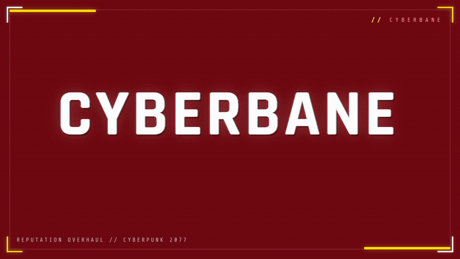

<a href="docs/assets/cyberbane.mp4">Watch the full video</a>

# Cyberbane

Cyberbane is a reputation overhaul for Cyberpunk 2077. Night City forms an opinion of V and acts
on it. Fight, finish jobs, install chrome and put a look together, and a reputation spreads
district by district. Crowds clear out of your way, gangs decide whether to respect you or hunt
you, and vendors move their prices. The enemies who got away from you, and the ones you beat and
left breathing, come back with names and grudges. A gang that wants you dead sends its crew with
its apex squad at the front, sized to how dangerous you have become, and a gang you keep hurting
loses its grip on its streets to the gangs at war with it.

Every reaction comes from something you did. When you want to know why the city treats you a
certain way, open the Hub: it spells out what each number means, and tells you exactly what the
city is doing about you right now.

**Download:** [CyberBane on Nexus Mods](https://www.nexusmods.com/cyberpunk2077/mods/35847)

**Status: released (1.7.7).** Built for Cyberpunk 2077 v2.5 and v2.31, from one download, and
in active development. This page describes what the mod does and how it installs.

## What it does

- **Reputation you earn.** Two main scores grow from your actions: Renown (how widely you are
  known) and Dread (how frightening you are). Word spreads outward from where things happened,
  so you can be a legend in Watson while Pacifica has never heard of you. Dread comes down too:
  cover your chrome or dress down and it drops at once, and while you lie low your body count
  and the stories about your jobs fade a little every day, down to what your whole record still
  earns. Go three in-game days without putting anybody down and the city forgets twice as fast,
  until the next one. The Standing screen on the Hub says what you are feared for most and what
  brings it down; **Decay rate** sets how fast it fades.
- **A reputation for how you work.** Night City also reads your conduct. Leave people breathing
  when you could have finished them and you get treated as disciplined: vendors give you a
  little goodwill, and the street talks about you with respect rather than fear. Somebody you
  put down alive adds a quarter of the Dread a body does. Gun down
  civilians, or kill by hand with a blade, and the Street starts talking about you the way it
  talks about cyberpsychos, one bad night from going over. How you kill counts separately from
  how much: a blade and bare hands read as brutal, a gun does not, and a club is its own thing.
- **Word spreads because somebody saw it.** Reputation travels on witnesses. Leave people
  alive and your name moves fast and far; leave nobody and the street never learns who did
  it, so you build almost no reputation you can claim and the story barely leaves the
  district. What you do get instead is a district with a name for something it cannot
  identify. It turns the signature mechanic into a decision you make in every fight.
- **Wear a mask and nobody can say it was you.** People still see what happened, they just
  cannot put your name to it, so your reputation barely grows, no story about you travels, and
  gangs are slow to turn against you. Nobody scatters from you in the street either: whatever
  you are known for, a stranger has no way to attach it to the person walking past them. The
  bodies still turn up, so the district gets frightened of something it cannot identify.
  Anonymity costs you fame, which is the trade. Glasses and visors do not count; they only hide
  the chrome in your eyes.
- **The city texts you, on your own phone.** Everyone who gets in touch is a contact in V's
  phone: the gang that has decided to come for you, the broker who works the district you are
  in, a Rival who has found you, an unknown number. A new message arrives the way the game's own
  texts do, with the same notification and tone, and opening the contact shows the whole thread
  in the phone's messenger. The broker for a district is the same person every time, they get
  in touch when your name reaches their part of town, and if you walk into a district where word
  about you got there first, they mention it.
- **You can answer.** When a gang you could buy off texts you something hostile, you can reply
  from the phone the way you reply to anyone in the game: pay what they want to call it off, or
  tell them no. Paying is the same deal the Hub brokers, at the same price, and it calls off
  anything they already had on its way. Any gang that already wants you dead names its price
  once a session without being prompted, so the offer is there whether or not you were around
  the moment they turned on you.
- **Anyone the mod sends after you is on your map and minimap.** Rivals, apex squads and crews carry
  their own marker: gold for a Rival, purple for an apex squad, white for a crew. You can pick the
  one that matters out of a street full of gangers, and nobody reads as police. On the big map it
  sits under the **Your Property** filter, and hovering it says who it is. It stays on the minimap
  for the whole fight. The one over their head comes off while they are fighting you, because the
  game marks enemies in combat by itself. You can narrow them to the named ones or turn them off.
- **Die, and whoever killed you gets the credit.** The enemy who put you down becomes a named
  rival, or climbs a rank if they already were one, and their gang starts reading you as
  somebody who can be beaten. It lands the moment you go down, so it works with a death
  alternative such as [Fenix Rebirth](https://www.nexusmods.com/cyberpunk2077/mods/28954)
  carrying you through without a reload, and it works on its own. Nothing to install or
  configure either way.
- **A cyberpsycho you take alive might come looking for you.** Regina asks you to leave them
  breathing and the game never follows it up. There is an even chance one you spared turns up
  later as a rival, under their own name, having learned how you fight. They are no tougher
  than they were the first time; they are just better at it. Kill them instead and that is the
  end of it.
- **You overhear the city talking about you.** People near you say things about you, shown as
  a line of subtitle near the bottom of the screen. Lines change with the gang, the district and
  the title you are carrying, and when a story about something you did has actually travelled to
  where you are standing, that is what people are talking about.
- **The street gets word back to you.** When a rumour about you reaches somewhere new, a
  contact may get in touch about what they heard. If people saw you, your name is in it. If
  nobody did, it arrives as a question about who is doing this.
- **A city that reads how dangerous you look.** The more frightening you are, the more people
  give way. Passers-by look over at you, flinch and step aside, freeze with their hands up when you
  are right on top of them, and run only if you are truly terrifying and close. Gang members and cops
  size you up, and panicked drivers pull away in the street. It is not only your reputation: visible chrome, and how
  built-up your level, Street Cred and skills are, all feed into how much the street fears you,
  so a heavily chromed, high-level merc clears a room. Bosses and MaxTac hold their ground.
- **What you wear hides what you are carrying.** Chrome only frightens people who can see it.
  A coat covers your arms and skin, trousers cover your legs, and anything across your face
  covers your eyes, so the same build reads very differently dressed up or stripped down.
  Covered chrome still counts for a little, because a coat moves and heavy arms change how you
  carry yourself.
- **Gangs with their own values.** Maelstrom cares about chrome, the Animals care about raw
  strength, the Voodoo Boys care about netrunning. The same V gets different treatment from each
  gang depending on your standing and reputation: respect, a warning, or hostility. Masks and hoods
  make you harder to place, and a gang's own gear makes that gang slower to recognize you: nomad
  clothing with the Aldecaldos and the Wraiths vest with the Wraiths, the only gang clothes V can wear.
- **Gangs at war with each other.** The Valentinos and 6th Street, the Tyger Claws and the Mox,
  the Aldecaldos and the Wraiths, Arasaka and Militech, and everybody against the Scavs. Hurt a
  gang and the gangs that hate it warm to you, by how much it hurt and by whether anybody saw it
  was you. A gang that comes round tells you so. Once they are friendly their people stop
  backing away from you, vendors on their turf give you better prices, and they warn you when
  their enemies send people after you. Vendors on the turf of a gang that wants you dead charge
  you more.
- **Turf wars.** Every gang's streets are split between the gangs that work them, and the
  stronger gang holds more. Each of their people you put down weakens a gang a little; an
  officer, a boss, one of their Rivals, a whole crew or their apex squad, a lot. They rebuild
  while you leave them alone. Break a gang and the gang at war with it next door moves in: break
  the Valentinos and 6th Street walks into Heywood, until the Valentinos are strong enough to
  take it back. The street texts you when a district changes hands, the History screen keeps it,
  and the Hub's Turf screen shows who holds each district, how firmly, and who is fighting them
  for it. Whoever holds a district is the gang whose lookouts watch you there, whose crews know
  where you are and whose vendors know where you stand with them. Turf wars can be turned off,
  under Gangs.
- **Enemies that break, run, and remember.** Wound an enemy badly and it can lose its nerve and
  try to escape. Catch it and that is the end of it; let it get away and it comes back as a named
  Rival with a grudge. Beat one down and walk away without finishing them and they can come back
  too, taking the mercy personally. Rivals are a full nemesis system: they hunt you down and
  chase you, they climb the ranks on their own while you are busy elsewhere, and every time one
  escapes it returns a rank higher and scarred. Each one is built to the same grade as a member
  of an apex squad, and they keep getting stronger: every escape, every mercy and every time
  they put you down makes the one who comes back harder than the one who left. Each arrives
  with a bar at the top of the screen carrying their name, and texts you when they have found
  you. Scan one and the scanner gives that name too, over their class, the way it names an NCPD
  target. Put down the one hunting you and it is finally finished. Anyone who kills you can also
  come back, wearing the face they had when they did it, and dropping a crew's member can bring
  a gang-mate gunning for you.
- **You can go after them too.** A Rival who walks away from you alive gets seen somewhere
  afterwards. Now and then a gang at war with theirs, or somebody on the street, texts you where,
  and a pin goes on your map and minimap: Cyberbane's own mark, a gold bounty-hunt glyph that
  nothing else in the game puts on a map, and the same mark a Rival carries on your minimap when
  they come for you. Hover it on the map and it names the Rival. Select it and track it for a
  route. It sits under the **Your Property** filter, with your own waypoint and cars, so it only
  disappears if you turn that filter off. Get there and get out of the car, and
  they are there, somewhere round the place you cannot see from where you stand, not expecting
  anybody: catch them before they react and the street hears about it. Wait too long and they move on. They still
  come for you on their own schedule as well. **Tips on where Rivals are**, under Rivals, turns
  this off.
- **Rivals have traits, and weak spots.** A Tough Rival takes more killing, an Armored one
  shrugs off more of it, a Deadeye finds the gap in your armour, a Quick one dodges, a Pack
  Leader brings two of their own (so does a crew leader, and a lieutenant brings one), a
  Grudge-Bearer is always first in line, and somebody Hard to Scare never breaks and runs. Escaping you half dead leaves them Scarred, and doing it twice
  leaves an Old Wound. Sparing one leaves them Shaken, and an avenger comes in Reckless. The
  Rivals screen lists them for whoever is coming next.
- **They drive over.** Crews, apex squads and Rivals come after you by car, whether you are driving
  or on foot, wherever a car can be put down out of sight. If you are on foot they get out when it
  reaches you; if you are behind the wheel they stay in and chase. If the car seats fewer than the
  gang sent, gets stuck or never makes it, the rest come on foot, so an apex squad is always four.
  Indoors, or anywhere there is no room for a car, they come on foot.
- **A vendetta is a decision.** A gang that has sworn one is already putting a
  crew together, and the Hub tells you how long you have. How many turn out depends on how much
  of a problem they think you are. Pay them off while they are on the way and they turn around.
- **A crew comes with its best.** Every crew a gang sends is led by its apex squad: four of its
  best, one heavy, one shooter, one blade and one netrunner, with the rest of the crew behind
  them. The text tells you who is leading them and how many follow. They stay until the fight is
  settled: until you put them down, or get far enough away and stay gone long enough that they
  give up. **Crews bring the apex squad**, under Gangs, sends the crew alone.
- **They come for a reason.** A gang that wants you dead sends a crew when it has a reason
  today: you killed their people where somebody saw it, you have been hanging around on their
  streets long enough for a lookout to call it in, you hurt them in the last half a day, or they
  have sworn a vendetta. A gang that hates you but has not seen or heard of you in a day keeps
  its people at home. Wipe out one of their crews and their apex squad is next, and they text
  you to say who is coming.
- **Being hunted.** First you hear somebody is asking about you. Then whoever is coming texts
  you and you get time. They arrive out of sight and go straight for the word they have on you,
  running, in a ring that closes on you from their side, the way the police do. A gang that does
  not know where you are may
  send one scout first, who calls in the crew only if they keep eyes on you. A glimpse is not
  enough for them: crouching, the dark and their own gang's colours make you harder to find, and
  a safe area or a drive out of the district makes them give up sooner. Until one of them has
  actually found you, you are not in combat: your phone, saving and fast travel all work while
  they are still looking. One line on the HUD says who it is, how big a threat, and whether they
  are tracking you, on their way, searching, have spotted you or have you. Anybody who gets stuck
  somewhere neither of you can reach is taken out of the fight once you cannot see them.
- **Worth the fight.** Anyone the mod sends who you put down leaves you something, scaled
  to who they were and to your level: cash, ammo and parts from a crew, better parts from a Rival the higher they
  ranked, rare and epic parts from an apex squad with a chance of legendary ones, and a small
  chance of an iconic weapon from apex squads, top Rivals and crew leaders. Only iconics you
  could otherwise find exploring the city can drop; quest, gig and story weapons never do. Put
  down a Rival or wipe out a crew or an apex squad and a gang at war with theirs pays you a
  bounty. Run from a crew instead and that gang thinks less of you, though they do leave you
  alone for a while.
- **The day has a shape.** A day in Night City is split into three stretches of eight hours,
  and each kind of trouble gets its own window inside them, staggered so a Rival and an apex
  squad sharing a stretch arrive hours apart rather than together. Three Rivals means one in
  each stretch; crews and apex squads take two stretches each, and which ones is decided fresh
  every day, with the exact moment inside a window left to chance so it never becomes a
  timetable you can learn. How many of each per day is up to you. Sleeping or fast travelling
  past a window simply misses it, so you never arrive somewhere and get everything you were
  owed at once. The timetable only says when the city has time for you; a gang still needs a
  reason to come. Prefer no pattern at all? Set **When they come** to Unpredictable, or to
  Reactive so nobody comes unless you give them a reason, and turn off **Show countdowns** to
  see "soon" and "later" in place of exact times.
- **You can lose them.** Being hunted is a chase you can win. Get far enough from all of them
  and stay clear long enough and they give up, the same way the police in this game do. A Rival
  you shake takes it personally and comes back promoted, so getting away still costs you
  something.
- **A city that pays attention.** Frighten a gang enough and they may send tribute to stay on
  your good side, or a hit squad to deal with you. Give a hit squad the slip and a survivor can
  come back as a named Rival who hunts you. Vendors give fear or respect discounts, and fixers pay
  the famous a bonus on job payouts. You can also buy your way out of a vendetta by brokering peace
  with a gang from the Hub, and the price reflects what they actually think of you: the bodies,
  how badly their standing has fallen, and double again if they have sworn a vendetta. Paying
  them off calls off anything they already had on its way.
- **Gangs send an apex squad.** An apex squad leads every crew, and a gang can also send it on
  its own: wipe out one of their crews while you are at war with them, after enough of their
  people have gone down, and the people who matter come for you with a couple of their own behind
  them - a carload of four named enforcers who fight like MaxTac. Pile up twice the bodies and
  they come without waiting for a crew. An apex squad is always four: whoever a car could not
  seat, or the street would not take on the first try, walks in after them. There is a heavy who walks at you and breaks your guard,
  a shooter who flushes you out of cover, a blade who closes in and stays on you, and a
  netrunner who hangs back and hacks you. Each chair is filled from that gang's own people of that
  kind, and a gang with nobody of a kind sends the nearest thing it really fields, so they carry
  the right weapons and fight the way that kind of enemy fights, and they work as a squad. Each of them gets a bar at the top of the screen showing their role and their
  gang, the way a MaxTac drop reads as a heavy, a blade, a netrunner and a shooter, so you can
  always tell who you are fighting and whose people they are. Like MaxTac, they hold their
  ground: an apex squad never breaks and runs.
  You get a warning first, and a countdown. How dangerous they are is a slider, from a hard fight
  up to the game's own set-piece enforcers, and your own build scales it on top. On Hard and
  Very Hard, where the game already makes every enemy hit harder, Cyberbane adds less. Each one
  carries two traits of its own, so no two fight the same way. No story character is ever used,
  so nothing gets spoiled and you never meet a duplicate of someone you already killed. It
  works for every gang. The Hub keeps count of the ones you put down.
- **Gangs you cannot decapitate.** Every gang has a leader and up to three lieutenants, and
  your Rivals fill those chairs. Put the leader down and the strongest of the rest takes the
  crew, so there is always somebody next in line. A leader takes real killing; a lieutenant
  takes more than the rank and file.
- **Rivals carry your marks.** Set one on fire and the one who comes back is burned. Shoot
  them, cut them, or fry them with a quickhack and they wear that instead, and the Hub shows
  it on their line.
- **Jobs count.** Finishing gigs, jobs and NCPD work builds your reputation, with bigger
  contracts worth more than street hustles.
- **Titles and the file they keep on you.** Earn titles such as Butcher of Watson, Chrome
  Saint, or the top title Cyberbane; the street tells you when it starts calling you something
  new. The History screen is the street's file on you, written as plain sentences: the Rivals
  you made and put down, the apex enforcers and bosses people saw you kill, the vendettas sworn,
  the gangs that came round to you, the peace you bought and the tribute you took.
- **The Hub.** A tab of its own at the top of the game menu, after Journal, built from the game's own
  tabs, buttons and hints so it looks like the screens around it. If you would rather have it in the
  pause menu, there is a setting for that. Click a screen to switch: Standing, Gangs, Turf, The City,
  Rivals, Titles and History. Your scores are meters, gangs and rivals are colour-coded rows, and the first
  screen shows what each of the three lanes has on its way and when, as it stood when you paused.
  If something cannot arrive, it says why. Click a gang to see what they are about to do and to pay
  them off, click a Rival for their file, and click a title to go by it. Standing tells you in plain
  words what Night City is doing about you right now and what it would take to change that.
  Messages live in your phone.

Cyberbane works anywhere in the open world. It adds no hand-placed scenes, and it is built to
leave quests, companions, romances and your saves alone. Whenever the story has the stage - a
scene, a set piece where the quest decides what you can use (a VR bout, a boxing match, a ride in
somebody's car), a story character walking with you, or any time you are playing as somebody other
than V - nobody is sent after you, anybody already on the way is called back out of sight, and
nothing you do as somebody else counts as V's.

## Requirements

Install these first, each from its own page and following that mod's instructions:

- RED4ext
- redscript
- Codeware
- Mod Settings

There are no optional requirements. Cyberbane reads your clothing through the game's own
equipment slots, so outfit mods are picked up without any integration.

Cyberbane supports Cyberpunk 2077 v2.5 and v2.31. The same download works on both: install the
versions of the required frameworks that match your game.

| Game | RED4ext | redscript | Codeware | Mod Settings |
| --- | --- | --- | --- | --- |
| 2.5 | latest | latest | latest | latest |
| 2.31 | 1.29.1 or 1.30.0 | 0.5.31 | 1.20.6 | 0.2.21 |

The 2.31 row is the last build of each framework made for 2.31; every later build needs 2.5. Use
the builds for the patch you are on and not the other one. Every other patch is treated as
unsupported until it has been checked, and a compatibility note goes out with every release.

If the game shows a red error when it starts, that is redscript saying a script did not compile,
and none of Cyberbane is running. Please send `r6\logs\redscript_rCURRENT.log` from your game
folder with the report, along with your game version: the log names the exact file, line and
other mod involved, which is the one thing that cannot be worked out without it.

## Installation

Download the latest `Cyberbane-x.y.z.zip` from the
[Releases page](https://github.com/tfthushaar/CyberBane/releases), then install it one of two ways.

### With Vortex (recommended)

1. Install the required mods listed above.
2. In Vortex, add the zip with "Install From File" (or drag it onto the Mods area), then enable it
   and click Deploy.
3. Launch the game, open the game menu and choose the Cyberbane tab to open the Hub.

### Manual

1. Install the required mods listed above.
2. Extract the zip into your Cyberpunk 2077 game folder, the one that holds `bin`, `r6` and
   `Cyberpunk2077.exe`. The zip's `r6` folder merges into the game's existing `r6` folder, so the
   scripts land at `r6\scripts\Cyberbane\`. A typical Steam path is
   `...\steamapps\common\Cyberpunk 2077\`.
3. Launch the game, open the game menu and choose the Cyberbane tab to open the Hub. You can
   rebind the key in Mod Settings.

To update by hand, extract the new zip over the old one. Any script the mod no longer uses is
replaced by an empty one at the same path, so there is nothing to delete, whichever version you are
coming from.

To uninstall, remove the `r6\scripts\Cyberbane` folder, or disable the mod in Vortex.

## Controls

The Hub is a tab of the game's own menu, so it uses that menu's controls. Cyberbane adds no keys of
its own.

- **The game menu, then Cyberbane:** the last tab in the row across the top, after Journal. Escape
  closes the menu as usual. With the game's radial hub turned on, it is in the row beside Character
  and Stats.
- **In the pause menu instead:** turn on "Hub in the pause menu" under Interface in Mod Settings.
  Then it is Escape, then Cyberbane, and 1 and 3 (LB and RB) change screen.
- **On the Hub:** click a screen name, or use A and D (LT and RT), to switch screens. A list longer
  than the page scrolls with the Up and Down buttons above it, the mouse wheel or the right stick. On Gangs, click a gang to see more
  and to pay them off (it asks you to confirm); on Rivals, click a Rival for their file, and use
  Forget every rival (it asks twice) to clear them; on Titles, click the title you want to go by, or
  Automatic for your highest one. Paying a gang off and forgetting your Rivals happen in the next few
  seconds of play, and can be cancelled until then. On History, Start over (it asks
  twice) clears everything you earned by playing and leaves everything that is read off your build,
  so your chrome and your look are untouched. Forgetting your Rivals and starting over both stick:
  quitting straight afterwards, or loading an older save of the same playthrough, does not bring
  anything back. Mod Settings, bottom right, goes straight to Cyberbane's settings.

## Uninstalling

Cyberbane makes no permanent changes to the game, so removing it stops every effect right away.

Cyberbane stores its progress inside your save. If you save the game while Cyberbane is not
installed, that save loses its Cyberbane data for good. Keep the mod installed to keep your
reputation, or make a backup save before you remove it.

## Settings

Everything is configurable from the in-game Mod Settings menu, and every option explains what
it does. You can turn individual systems on or off (crowds, gangs, morale, vendors, rivals, hit
squads, whispers), tune how intense and how frequent reactions are, pick a preset (Subtle,
Default, or Dramatic), and set the size of Cyberbane's own screens and bars.

Under UI you can also choose where messages go: Phone (the default) puts them in V's own phone,
Cards draws them on the left of the screen and keeps Cyberbane out of the phone entirely,
Notices uses the old line across the middle of the screen, and Off is silence. If the phone ever
misbehaves on your setup, Cards is the switch that takes Cyberbane back out of it. You can also
turn the message tone off and set how long anything on screen stays up. The map markers are
there too, as everyone Cyberbane sends, only the named ones, or none.

### Earning a gang's respect

Gangs warm to you for three reasons, and only the first involves anybody else's gang.

- **Hurting the people they are at war with.** This is the strong one, and the Gangs screen now
  names each gang's enemy so you can see who to lean on. It can carry a gang all the way to
  Allied.
- **Restraint.** Putting their people down without killing them costs their opinion far less
  than a body does, and each one you leave breathing earns a little goodwill. On its own this
  gets you tolerated, not adopted.
- **Mercy with a name.** Let one of their Rivals walk and the gang hears about it.

Friendly gangs cut their prices on their own turf and warn you when their enemies send people
after you. Hostile gangs send crews; Vendetta means they shoot on sight as well.

Big jobs count too. Finishing one of the city's larger stories shifts how the gangs involved
see you, which is why the Heist costs you Arasaka for a long time afterwards.

Wherever a car can be put down out of sight, they drive: it is picked to seat the crew it is
carrying, a big crew comes in several, and it drives to you. If you are on foot they get out and
search for you. Get in a car and they chase you in it. Indoors, or with no room for a car, they
come on foot. **Cars arrive on foot too**, under Gangs, is on by default; turn it off and they only
drive while you are driving. If cars ever misbehave on your setup, that is the switch to try first.

**Gangs lie in wait (experimental)**, also under Gangs, is off by default. With it on, a gang with a
vendetta against you may send a crew to wait in a parked car up the road while you are driving, and
pull out as you go past. Turn it off and arrivals work exactly as they do without it.

### Playing without the messages

If you like the mechanics but would rather not be told what is coming, set **Where messages go**
to **Off**. Nothing is put in your phone, no cards, no notices, no overheard lines and no message
tone. The **Show messages** switch does the same thing, so either one is enough.

None of it changes the way the mod plays. Gangs still send crews, apex squads still come, Rivals
still hunt you, loot and bounties still arrive with the game's own notices, and the Hub still
shows you where you stand with everyone and still brokers peace. The only thing you give up is
the warning, which is the point if you would rather be surprised.

The top of the screen is separate again, so you can mix them. Three settings under Interface
cover it. **Hunt line on the HUD** is the line of text (TRACKED, HUNTED, SEARCHING and so on),
with Everything, HuntsOnly (only while somebody is actually on their way or out looking) and Off.
**District line** is the other thing that line says, where you stand in the district you are in:
Briefly puts it up when you arrive somewhere and when your standing there changes and then clears
it, which is the default, Always leaves it up, and Off never shows it. **District line, seconds**
is how long Briefly lasts. **Rival and apex bars** is the name and health bar under it for a Rival
who has come for you and for each member of an apex squad. Messages off with the hunt line on keeps the one line and loses
the texts; everything off means the first you know about it is when they walk round the corner.

### Starting over

Under Debug there is **Reset all Cyberbane data**. Turn it on, hit Apply, and everything
Cyberbane has recorded on this save is cleared: Renown, Dread, Conduct, every faction and
district, your Rivals, your titles, the log and all the tallies. The switch turns itself back
off once it is done, and it cannot be undone. Every other save of the same playthrough is
cleared too the next time you load it, so an older save cannot bring it back. A save from a
different playthrough is never touched, even if you load one before going back to the game.

Your cyberware rating is not part of that, because it is not stored progress. It is read back
off the chrome you are actually wearing every few seconds, so it returns on its own.

Use it if a playthrough has ended up somewhere you did not intend, which is easy to do with
Conduct, and you would rather start the city's opinion of you from nothing than start a new
save.

Three worth knowing about if a playstyle is being treated unfairly:

- **How many of each kind reach you per day**, set separately for Rivals, gang crews and apex
  squads. Turn one to zero to switch that kind off entirely.
- **How frightening unseen work is.** By default half of a killing nobody witnessed still
  counts toward how frightening you are, because the bodies turn up either way. Turn it down if
  you work quietly and do not want the street reacting to you, or to zero so only what people
  actually saw counts.
- **Whether melee kills cost Conduct.** Killing by blade, bare hands or takedown counts against
  you only when somebody sees it. Turn it off if how you kill should be your own business.

## Compatibility

- They Will Remember: supported, detected exactly and automatically. Cyberbane backs off the
  systems that overlap (hostility on sight, hit squads, faction-colour disguises), keeping the
  rest. Night City Remembers is treated the same way, since it replaces They Will Remember. You
  can force the compatibility mode on or off yourself in Mod Settings.
- Phone Extension and mods built on it: work alongside. Cyberbane's phone contacts use names of
  their own, so both can add contacts to the phone at once.
- Street Sense: supported, detected automatically, no setup. It owns crowds noticing and
  greeting you, so Cyberbane stands its own overheard lines down and keeps everything else.
- Much Better AI: supported, detected automatically, no setup. Its Nerve system owns morale,
  so Cyberbane stands down its own morale break and terror push rather than panicking the same
  enemy twice, and it also owns equipping enemies, so Cyberbane leaves its own ability kits off
  rather than doubling up on the same enemy. It keeps tracking who got away, so
  Rivals still come from enemies Much Better AI sent running, and everything that is Cyberbane's
  own still runs: who gets sent after you, when, in what, and the boss bar.
- Responsive NPCs: works alongside. If crowd reactions feel doubled, lower civilian intensity or
  disable one side's crowd reactions.
- Night City Alive and other crowd or patrol mods: supported.
- AMM, romance and companion mods, quest NPCs and unique characters: always left untouched.
- Safe areas: in places the game itself treats as safe, such as apartments, clinics, bars and
  memorials, Cyberbane's reactions stand down and nobody there responds to you. Nobody is sent
  after you in one either, because the game forces your hands empty in those places and that
  would be a fight you could not have. If you want it anyway, two settings under Safe areas
  turn it on and lift the weapon lock, both off by default.
- New Game Plus: supported, detected automatically, no setup. It rebuilds every NPC in the game
  to be harder, and its buffs and Cyberbane's would multiply rather than replace each other, so
  Cyberbane halves its own apex buffs and leaves the random traits to New Game Plus, which
  already hands them out. Starting one also starts a fresh reputation for the new playthrough.

## Credits

Built on the work of the Cyberpunk 2077 modding community: RED4ext by WopsS, redscript by
jac3km4, Codeware by psiberx, and Mod Settings by jackhumbert.

Thanks to cshiai, whose Much Better AI showed where the game signals a completed takedown and
how to detect another mod at compile time. Reading it is what fixed Cyberbane's takedowns. No
code from that mod is used here.

Thanks to Nolo for Grudge. Two of its designs are in Cyberbane now: Rivals carrying the scars
of how you hurt them, and gangs having a leader and lieutenants so a crew cannot be beheaded.
Different mod, good ideas. No code from that mod is used here.

Thanks to NovaAntonsito for Gang Retaliation. Its gangs that fight over districts, where the
stronger one wins and every name you put down weakens their gang, are the idea behind Cyberbane's
turf wars. Different mod, good ideas. No code from that mod is used here.

Thanks to DigitalVixen for Street Sense, which Cyberbane detects and makes room for.

Thanks to Spuddeh for NC Zoning District Guide (MIT). Its notes on why a mod's map pin must never
be the player's waypoint, and how to give a pin its own face on the map, the minimap and in the
world without an archive, are how the pin on a Rival's place became Cyberbane's own. Cyberbane's
version is written for its own pin; the technique and the two crashes to avoid are theirs.

Thanks to everyone who reported bugs and sent in crash reports, and especially to r3bels90, who
pinned down the exact cause of the world-transition crash and made the 0.1.6 fix possible. This
mod is better because of you.

## Legal

Free, non-commercial fan mod. It is never sold or paywalled. It is not affiliated with or
endorsed by CD PROJEKT RED, and Cyberpunk 2077 is a trademark of CD PROJEKT S.A. Licensed under
the MIT License (see `LICENSE`). It bundles no game files and no files from other mods.
