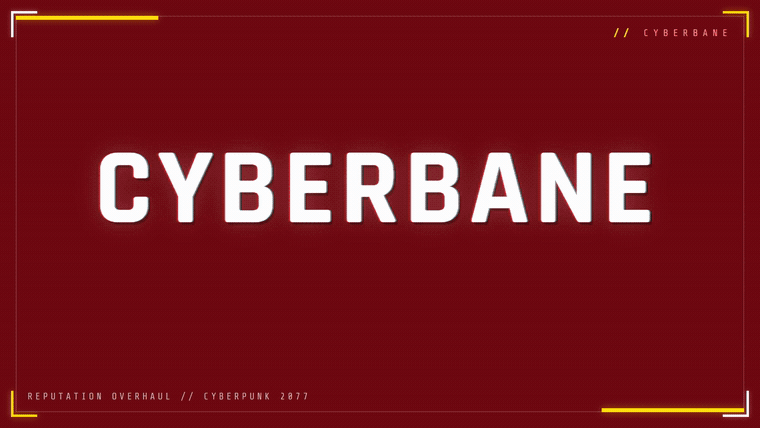

<a href="docs/assets/cyberbane.mp4">Watch the full video</a>

# Cyberbane

Cyberbane is a reputation overhaul for Cyberpunk 2077. As you fight, finish jobs, install
chrome and put together a look, Night City forms an opinion of V and acts on it. Pedestrians
get out of your way, gangs decide whether to respect you or run, vendors change their prices,
and the enemies who got away come back with names and grudges.

Every reaction comes from something you did. When you want to know why the city treats you a
certain way, open the Hub and read the breakdown.

**Download:** [CyberBane on Nexus Mods](https://www.nexusmods.com/cyberpunk2077/mods/35847)

**Status: early release (0.1.14).** Built for Cyberpunk 2077 v2.5 and in active development. This
page describes what the mod does and how it installs.

## What it does

- **Reputation you earn.** Two main scores grow from your actions: Renown (how widely you are
  known) and Dread (how frightening you are). Word spreads outward from where things happened,
  so you can be a legend in Watson while Pacifica has never heard of you.
- **A reputation for how you work.** Night City also reads your conduct. Do clean, controlled
  work and spare people when you can, and you get treated like a professional. Gun down
  civilians and lean on brutal finishers and the Street starts seeing a mad dog, one edge away
  from a cyberpsycho. It changes how people talk to you and how they deal with you.
- **A city that reads how dangerous you look.** The more frightening you are, the more people
  back off. Civilians, gang members and even cops can notice you, cower, or flee, and panicked
  drivers pull away in the street. It is not only your reputation: visible chrome, and how
  built-up your level, Street Cred and skills are, all feed into how much the street fears you,
  so a heavily chromed, high-level merc clears a room. Bosses and MaxTac hold their ground.
- **Gangs with their own values.** Maelstrom cares about chrome, the Animals care about raw
  strength, the Voodoo Boys care about netrunning. The same V gets different treatment from each
  gang depending on your standing and reputation: respect, a warning, or hostility. Masks and hoods
  make you harder to place, and wearing a gang's colours makes that gang slower to recognize you.
- **Enemies that break, run, and remember.** Wound an enemy badly and it can lose its nerve and
  try to escape. Catch it and that is the end of it; let it get away and it comes back as a named
  Rival with a grudge. Beat one down and walk away without finishing them and they can come back
  too, taking the mercy personally. Rivals are a full nemesis system: they hunt you down and chase you, they
  climb the ranks on their own while you are busy elsewhere, and every time one escapes it returns
  a rank higher and scarred. Put down the one hunting you and it is finally finished. Anyone who
  kills you can also come back, and dropping a crew's member can bring a gang-mate gunning for you.
- **A city that pays attention.** Frighten a gang enough and they may send tribute to stay on
  your good side, or a hit squad to deal with you. Give a hit squad the slip and a survivor can
  come back as a named Rival who hunts you. Vendors give fear or respect discounts, and fixers pay
  the famous a bonus on job payouts. You can also buy your way out of a vendetta by brokering peace
  with a gang from the Hub.
- **Gangs send an apex hunter.** Keep putting one crew in the ground and they stop sending squads
  and send someone who matters. You get a warning first, then a named hunter walks in with a couple of
  their people, built from the toughest member of that gang you have actually fought and lifted to
  boss grade so it is a real fight. They are sized to your build, so they stay a real fight as you
  get stronger. No story character is ever used, so nothing gets spoiled and you never meet a
  duplicate of someone you already killed. It works for every gang. The Hub keeps count of the
  ones you put down.
- **Titles and a history log.** Earn titles such as Butcher of Watson, Chrome Saint, or the top
  title Cyberbane, and review everything you have done in a timeline.
- **The Hub.** One screen in the game's own style, opened with F7 by default (rebindable). Each
  press steps through tabs for your reputation, the factions, the districts, your rivals, your
  titles, and the log; the press after the last tab closes it. Every screen explains what its
  numbers mean rather than throwing abbreviations at you, and the first one tells you exactly what
  the city is doing about you right now and what it would take to change that.

Cyberbane works anywhere in the open world. It adds no hand-placed scenes, and it is built to
leave quests, companions, romances and your saves alone.

## Requirements

Install these first, each from its own page and following that mod's instructions:

- RED4ext
- redscript
- Codeware
- Mod Settings

Optional:

- Native Interactions Framework, which adds the Intimidate interaction.
- Equipment-EX, which lets your outfit count toward your look.

Cyberbane is built for Cyberpunk 2077 v2.5. Install the 2.5 versions of the required frameworks
above. Each game patch is treated as unsupported until it has been checked, and a compatibility
note goes out with every release.

## Installation

Download the latest `Cyberbane-x.y.z.zip` from the
[Releases page](https://github.com/tfthushaar/CyberBane/releases), then install it one of two ways.

### With Vortex (recommended)

1. Install the required mods listed above.
2. In Vortex, add the zip with "Install From File" (or drag it onto the Mods area), then enable it
   and click Deploy.
3. Launch the game and press F7 to open the Hub.

### Manual

1. Install the required mods listed above.
2. Extract the zip into your Cyberpunk 2077 game folder, the one that holds `bin`, `r6` and
   `Cyberpunk2077.exe`. The zip's `r6` folder merges into the game's existing `r6` folder, so the
   scripts land at `r6\scripts\Cyberbane\`. A typical Steam path is
   `...\steamapps\common\Cyberpunk 2077\`.
3. Launch the game and press F7 to open the Hub. You can rebind the key in Mod Settings.

To uninstall, remove the `r6\scripts\Cyberbane` folder, or disable the mod in Vortex.

## Controls

Cyberbane adds one key, the Hub key, with two shortcuts layered on it. Everything else uses the
game's normal inputs.

- **Hub key (F7 by default):** opens the Hub, then steps through its tabs one press at a time; the
  press after the last tab closes it. Rebind it in Mod Settings. It will not open during combat.
- **Shift + Hub key (while the Hub is open):** brokers peace with the worst gang you can afford to
  buy off, paying from your eddies on the spot.
- **Ctrl + Hub key (while the Hub is open):** cycles your active title through the ones you have
  earned, or back to Auto (which always shows your highest title).

## Uninstalling

Cyberbane makes no permanent changes to the game, so removing it stops every effect right away.

Cyberbane stores its progress inside your save. If you save the game while Cyberbane is not
installed, that save loses its Cyberbane data for good. Keep the mod installed to keep your
reputation, or make a backup save before you remove it.

## Settings

Everything is configurable from the in-game Mod Settings menu. You can turn individual systems on
or off (crowds, gangs, morale, police, vendors, rivals, hit squads, whispers), tune how intense
and how frequent reactions are, choose pronouns, pick a preset (Subtle, Default, or Dramatic),
and rebind the Hub key.

## Compatibility

- They Will Remember: supported. Cyberbane spots it through Mod Settings and backs off the
  systems that overlap (hostility on sight, hit squads, faction-colour disguises), keeping the
  rest. Night City Remembers is treated the same way, since it replaces They Will Remember. You
  can force the compatibility mode on or off yourself in Mod Settings.
- Responsive NPCs: works alongside. If crowd reactions feel doubled, lower civilian intensity or
  disable one side's crowd reactions.
- Night City Alive and other crowd or patrol mods: supported.
- AMM, romance and companion mods, quest NPCs and unique characters: always left untouched.
- Safe areas: in places the game itself treats as safe, such as apartments, clinics, bars and
  memorials, Cyberbane's reactions stand down and nobody there responds to you.
- New Game+: starts a fresh reputation for the new playthrough.

## Credits

Built on the work of the Cyberpunk 2077 modding community: RED4ext by WopsS, redscript by
jac3km4, Codeware by psiberx, Mod Settings by jackhumbert, and the optional Native Interactions
Framework and Equipment-EX.

Thanks to everyone who reported bugs and sent in crash reports, and especially to r3bels90, who
pinned down the exact cause of the world-transition crash and made the 0.1.6 fix possible. This
mod is better because of you.

## Legal

Free, non-commercial fan mod. It is never sold or paywalled. It is not affiliated with or
endorsed by CD PROJEKT RED, and Cyberpunk 2077 is a trademark of CD PROJEKT S.A. Licensed under
the MIT License (see `LICENSE`). It bundles no game files and no files from other mods.
