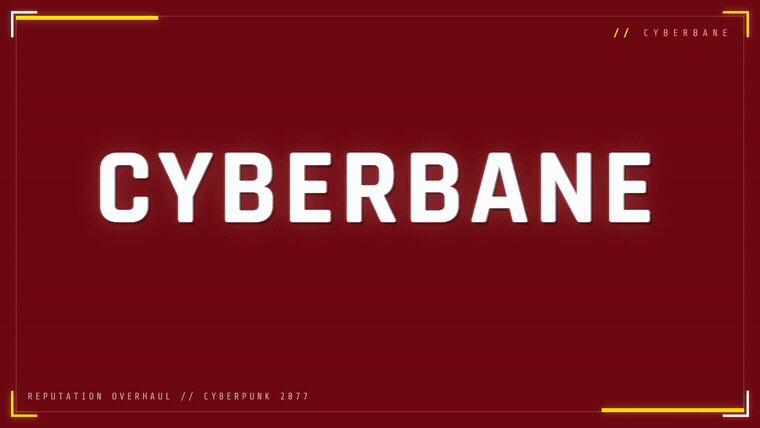

<a href="docs/assets/cyberbane.mp4">Watch the full video</a>

# Cyberbane

A reputation overhaul for Cyberpunk 2077. Night City notices what V does and acts on it: crowds get
out of your way, gangs decide whether to respect you or hunt you, and the people you hurt come back
with names and grudges.

**Download:** [Nexus Mods](https://www.nexusmods.com/cyberpunk2077/mods/35847) or the
[Releases page](https://github.com/tfthushaar/CyberBane/releases)

**Version 2.0.0.** Works on Cyberpunk 2077 **2.5** and **2.31** with the same download.
What changed in each version: [CHANGELOG.md](CHANGELOG.md).

## What it does

- **You build a reputation.** Fights, jobs, chrome and the way you dress all count. Word spreads
  district by district, so you can be a legend in Watson while Pacifica has never heard of you.
- **The street reacts.** People glance, step aside, freeze or run, depending on how frightening you
  are. Cover your chrome or wear a mask and they can't place you.
- **Gangs pick a side.** Help a gang's enemies and they warm to you: better prices on their turf and
  warnings when their enemies come for you. Keep hurting them and they send a crew, then their apex
  squad, by car or on foot. You can pay them off.
- **Rivals.** Enemies who escape you, or whom you beat and leave alive, come back later with a name,
  a rank, scars from how you hurt them, and their own people. Spare them, kill them, or let them climb.
- **Turf wars.** A gang you keep hurting loses its streets to the gang at war with it.
- **Messages in your phone.** Gangs, Rivals and street contacts text you, and some threads let you
  answer: pay a gang off, or haggle over where a Rival is hiding.
- **The Hub.** A Cyberbane tab in the game menu shows your standing, every gang, who holds each
  district, your Rivals, your titles and a history of what you did, and explains why the city
  treats you the way it does.

### New in 2.0

- **Talk to anybody.** Walk up to someone with empty hands and press F. Ask questions, buy a Rival's
  hiding place, pay for safe passage, or talk down a ganger who is about to draw.
- **Make the street talk.** Grab a ganger, crouch over one you put down, or scan one, and they give
  something up, sometimes a Rival's fatal flaw.
- **Rivals with a life.** Catchphrases, family who take a fallen Rival's place, call-outs to a place
  they name, bodyguards, and mercy as your choice.
- **A living street.** Bagmen to rob, favours for friendly gangs, and sit-downs between gangs at war
  that you can crash.

## Requirements

Install these first:

- [RED4ext](https://www.nexusmods.com/cyberpunk2077/mods/2380)
- [redscript](https://www.nexusmods.com/cyberpunk2077/mods/1511)
- [Codeware](https://www.nexusmods.com/cyberpunk2077/mods/7780)
- [Mod Settings](https://www.nexusmods.com/cyberpunk2077/mods/4885)

Use the framework versions that match your game:

| Game | RED4ext | redscript | Codeware | Mod Settings |
| --- | --- | --- | --- | --- |
| 2.5 | latest | latest | latest | latest |
| 2.31 | 1.29.1 or 1.30.0 | 0.5.31 | 1.20.6 | 0.2.21 |

## Install

**Vortex:** add the zip with "Install From File", enable it and Deploy.

**By hand:** extract the zip into your Cyberpunk 2077 folder (the one with `bin` and `r6`). The
scripts end up in `r6\scripts\Cyberbane\`. To update, extract the new zip over the old one.

To uninstall, delete `r6\scripts\Cyberbane` or disable the mod in Vortex. Your Cyberbane progress
lives in your saves: a save made while the mod is removed loses it.

## How to play

- **The Hub:** open the game menu and pick the **Cyberbane** tab, after Journal. Click a gang to pay
  them off, click a Rival to read their file, buy where they are hiding or forget them.
- **Talking:** look at somebody up close with empty hands, press F (A on a controller), scroll to pick
  a line. Reach for a weapon and the conversation ends.
- Cyberbane adds no keys of its own.

## Settings

Everything is in **Mod Settings > Cyberbane**. The first page, **General**, has what most people
change: Cyberbane on or off, a preset (Subtle, Default, Dramatic), where messages go, the hunt line
at the top of the screen, and map markers. The pages after it go deeper, one subject each, with
**Advanced** at the bottom.

- **Fewer interruptions:** set **Where messages go** to Off. Nothing about how the mod plays changes.
- **Leave a gang alone:** switch it off under **Factions**. Cyberbane stops reacting for that gang
  and keeps your standing for later. The NCPD can be switched off the same way.
- **How often you are hunted:** **How often they come** sets how many Rivals, crews and apex squads
  reach you per day. Zero turns that kind off.
- **Start over:** **Reset all Cyberbane data** under **Advanced** (or Start over on the Hub's History
  page) wipes this playthrough's reputation. It can't be undone.

Each playthrough keeps its own record, and nothing one character does reaches another.

## Compatibility

- **They Will Remember / Night City Remembers:** detected automatically. Cyberbane lets it decide
  who is hostile to you. Set compatibility to Off under Advanced to let Cyberbane decide instead.
- **Much Better AI, Street Sense, New Game Plus:** detected automatically; Cyberbane steps back
  where they already cover something.
- **Equipment-EX and other outfit mods:** your outfit is read as it looks on V.
- **Phone Extension:** works alongside.
- **Companions** (the game's and modded ones) fight the people Cyberbane sends after you.
- **Story characters, quest NPCs, AMM and romance mods** are never touched.
- **Safe areas:** nothing happens in apartments, clinics, bars and other places the game treats as
  safe. Two switches under **Safe areas and jobs** change that.

## Reporting a bug

If the game shows a red error at start-up, a script failed to compile and Cyberbane is not running.
Send `r6\logs\redscript_rCURRENT.log` from your game folder with your game version. Send it for any
other bug too: Cyberbane writes what it was doing into the same file.

## Credits

Built on RED4ext (WopsS), redscript (jac3km4), Codeware (psiberx) and Mod Settings (jackhumbert).

Ideas borrowed with thanks, no code used: Much Better AI by cshiai (takedown detection), Grudge by
Nolo (Rival scars, gang leaders and lieutenants), Gang Retaliation by NovaAntonsito (turf wars),
Street Sense by DigitalVixen, and NC Zoning District Guide by Spuddeh (MIT; the custom map pin).

Thanks to everyone who sent bug reports and crash logs, and especially r3bels90.

## Legal

Free, non-commercial fan mod, never sold or paywalled. Not affiliated with or endorsed by CD PROJEKT
RED; Cyberpunk 2077 is a trademark of CD PROJEKT S.A. MIT License (see `LICENSE`). It bundles no
game files and no files from other mods.
